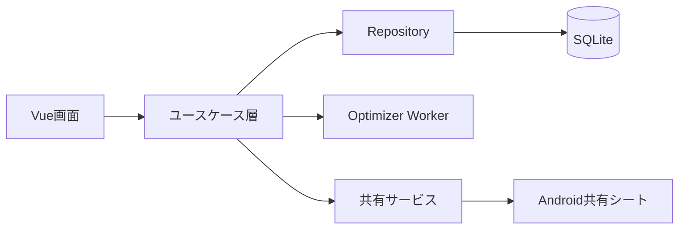
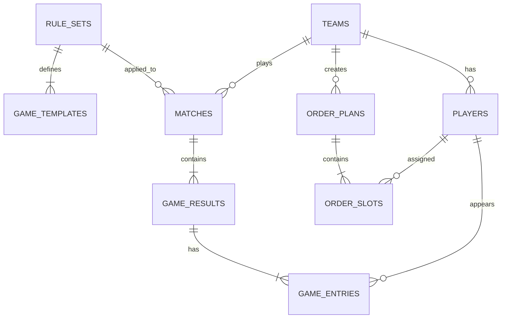

# JPL Order Maker Androidアプリ 設計書

| 項目 | 内容 |
|---|---|
| 文書バージョン | 1.0 |
| 作成日 | 2026-09-09 |
| 対象 | Android版 JPL Order Maker |
| ベースアプリ | `index.html` / `app.js` で構成された現行Webアプリ |

## 1. 目的

現行のオーダー作成機能をAndroidアプリ化し、過去の試合結果と選手別スタッツから、その日の参加選手に対する推奨オーダーを端末内で作成する。

完成したオーダーは、Androidの共有機能を通じてLINE、メール、チャットなどへ共有できるようにする。

## 2. スコープ

### 2.1 初期リリースに含める機能

- チーム管理
- 選手管理
- 選手のレーティング管理
- 試合と対戦相手の登録
- 各ゲームの出場選手、勝敗、スタッツ登録
  - 01ゲーム：出場選手ごとのPPR（Point Per Round）
  - CRゲーム：出場選手ごとのMPR（Mark Per Round）
- 過去成績の一覧・集計
- 当日の参加選手・出場条件の設定
- オフラインでの推奨オーダー生成
- 推奨理由、評価値、データ信頼度の表示
- 推奨オーダーの手動修正・固定
- 完成オーダーのテキスト／画像共有
- JSONバックアップと復元
- 現行アプリのローカルデータ移行

### 2.2 初期リリースに含めない機能

- 複数端末間のリアルタイム同期
- チームメンバーによる共同編集
- 対戦相手側のオーダー自動予測
- サーバー上での最適化処理
- iOS版

これらはデータ構造を大きく変更せず追加できる将来機能とする。

## 3. 前提と設計上の判断

### 3.1 ゲーム構成

初期値は現行アプリの13ゲーム構成を引き継ぐ。

| G | 種目 | 形式 | 人数 |
|---:|---|---|---:|
| 1 | 901 | 3vs3 | 3 |
| 2 | CR | 3vs3 | 3 |
| 3 | 701 | 2vs2 | 2 |
| 4 | 501 | 2vs2（ダブルイン・ダブルアウト／フリーズ） | 2 |
| 5 | 701 | 1vs1 | 1 |
| 6 | CR | 1vs1 | 1 |
| 7 | 901 | 3vs3 | 3 |
| 8 | CR | 3vs3 | 3 |
| 9 | CR | 2vs2 | 2 |
| 10 | 501 | 2vs2（ダブルイン・ダブルアウト／フリーズ） | 2 |
| 11 | 701 | 1vs1 | 1 |
| 12 | CR | 1vs1 | 1 |
| 13 | 1101 | 4vs4 | 4 |

ゲーム構成と最大出場数は設定データとして保持し、ルール改定時にアプリ更新だけで変更できる構造にする。初期設定では同一選手は1ゲームに1回、全体で最大7ゲームまでとする。

### 3.2 スタッツの登録単位

PPR／MPRはゲーム全体の値ではなく、ゲームに出場した選手ごとの値として保存する。複数人ゲームでも、各選手のスタッツを個別に入力できる。

- 01ゲームではPPRのみ入力可能
- CRゲームではMPRのみ入力可能
- 未計測の場合は未入力を許容する
- 勝敗はスタッツ未入力でも保存可能
- PPRとMPRは尺度が異なるため、最適化時に直接比較しない
- 501ダブルスはダブルイン・ダブルアウトルールのフリーズ方式として記録し、通常の01とは別条件でPPRと勝率を評価する

### 3.3 チーム共有

初期リリースの「共有」は、完成したオーダーをAndroid標準の共有シートから外部アプリへ送ることを指す。

- テキスト：LINE等へ貼り付けやすい形式
- PNG画像：閲覧環境に依存しないオーダー表
- JSON：バックアップおよび別端末への引き渡し用

共有後のデータはスナップショットであり、送信先での変更は元のアプリに反映しない。URLによる閲覧や共同編集が必要になった場合は、第2段階として共有用バックエンドを追加する。

### 3.4 ダーツライブ2のハンデ

JAPAN LEAGUE ハンディマニュアルのRt差表をアプリへ内蔵する。オーダー作成時に対戦相手の想定平均Rtを入力し、自チーム候補の合計Rtと「相手平均Rt×ゲーム人数」の差から、S701、D501、D701、T901、G1101、S・D・T Cricketのハンデを算出する。

- 自チームの合計Rtが低い場合：表のハンデを受ける有利さを評価へ加算
- 自チームの合計Rtが高い場合：相手へハンデを与える影響を評価から減算
- Rt差は整数へ丸め、表の上限25までを使用
- 表が「-」の組み合わせはハンデなしとして扱う
- 相手Rtが未入力の場合は、従来どおりハンデ補正なしで提案する
- 算出したRt差と点数・マーク条件を提案理由に表示する

## 4. システム構成

### 4.1 採用技術

| レイヤー | 技術 |
|---|---|
| UI | Vue 3 / TypeScript |
| 状態管理 | Pinia |
| 画面遷移 | Vue Router |
| ビルド | Vite |
| Androidコンテナ | Capacitor |
| ローカルDB | SQLite（Capacitor対応プラグイン） |
| 設定値 | Capacitor Preferences |
| 最適化 | TypeScript、Web Worker内で実行 |
| 共有 | Capacitor Share＋画像生成 |
| 入力検証 | TypeScriptの型＋スキーマ検証 |
| テスト | Vitest / Playwright / Android実機テスト |

CDN上のVueおよびTailwind CSSには実行時に依存せず、必要なファイルをAPKへ同梱する。機内モードでも、データ登録、集計、オーダー作成をすべて利用できる。

### 4.2 論理構成



### 4.3 レイヤー責務

- Presentation：画面表示、入力、バリデーション結果の表示
- Application：試合保存、集計、提案生成、共有などのユースケース
- Domain：ゲーム形式、成績評価、制約、オーダー候補
- Infrastructure：SQLite、Preferences、Android共有機能
- Optimizer Worker：候補生成と探索をUIスレッド外で実行

## 5. 画面設計

### 5.1 画面一覧

| ID | 画面 | 主な機能 |
|---|---|---|
| S01 | ホーム | 次の試合、直近成績、主要操作への導線 |
| S02 | チーム選択・管理 | チーム追加、編集、削除、切替 |
| S03 | 選手管理 | 選手、レーティング、在籍状態の編集 |
| S04 | 試合履歴 | 過去試合の検索、閲覧、編集 |
| S05 | 試合登録 | 対戦情報、13ゲームの勝敗・スタッツ入力 |
| S06 | 選手成績 | 01／CR、形式別、期間別の集計 |
| S07 | オーダー条件 | 参加者、最大出場数、固定枠などを設定 |
| S08 | 提案結果 | 推奨オーダー、評価、理由、候補切替 |
| S09 | オーダー編集 | タップ操作で入替、固定、再計算 |
| S10 | 共有プレビュー | テキスト／画像の確認と共有 |
| S11 | 設定・バックアップ | ルール設定、JSON出力・復元 |

### 5.2 主要フロー

#### 試合結果登録

```text
ホーム → 試合登録 → 対戦情報入力 → 各ゲーム入力 → 確認 → 保存
```

各ゲームの入力項目は次のとおり。

- 出場選手
- 勝ち／負け／引き分け／未確定
- 01の場合：各選手のPPR
- CRの場合：各選手のMPR
- 任意メモ

#### オーダー作成

```text
ホーム → オーダー条件 → 自動提案 → 候補比較 → 手動修正 → 確定 → 共有
```

ユーザーは自動提案前に、以下を指定できる。

- 当日の参加選手
- 選手ごとの最大出場数
- 出場不可の種目・形式
- 必ず出すゲーム
- 確定済みの選手枠
- 公平性をどの程度考慮するか

## 6. データ設計

### 6.1 ER概要



### 6.2 テーブル

#### teams

| 列 | 型 | 制約・説明 |
|---|---|---|
| id | TEXT | UUID、主キー |
| name | TEXT | 必須 |
| created_at | TEXT | ISO 8601 |
| updated_at | TEXT | ISO 8601 |

#### rule_sets

| 列 | 型 | 制約・説明 |
|---|---|---|
| id | TEXT | UUID、主キー |
| name | TEXT | ルールセット名 |
| version | INTEGER | ルール改定の識別用 |
| default_max_appearances | INTEGER | 初期値7 |
| is_active | INTEGER | 0/1 |

#### game_templates

| 列 | 型 | 制約・説明 |
|---|---|---|
| id | TEXT | UUID、主キー |
| rule_set_id | TEXT | rule_sets.id |
| game_no | INTEGER | ルールセット内で一意 |
| game_name | TEXT | 501 / 701 / 901 / 1101 / CR等 |
| rule_type | TEXT | ZERO_ONE / CRICKET |
| format_size | INTEGER | 必要出場人数 |
| in_rule | TEXT | OPEN_IN / DOUBLE_IN。CRではNULL |
| out_rule | TEXT | OPEN_OUT / MASTER_OUT / DOUBLE_OUT。CRではNULL |
| team_rule | TEXT | STANDARD / FREEZE |

#### players

| 列 | 型 | 制約・説明 |
|---|---|---|
| id | TEXT | UUID、主キー |
| team_id | TEXT | teams.id |
| name | TEXT | 必須 |
| rating | REAL | 0以上 |
| is_active | INTEGER | 0/1。履歴維持のため原則物理削除しない |
| created_at | TEXT | ISO 8601 |
| updated_at | TEXT | ISO 8601 |

#### matches

| 列 | 型 | 制約・説明 |
|---|---|---|
| id | TEXT | UUID、主キー |
| team_id | TEXT | teams.id |
| rule_set_id | TEXT | 使用したrule_sets.id |
| played_on | TEXT | 開催日 |
| opponent_name | TEXT | 対戦相手名 |
| competition | TEXT | 大会・シーズン名、任意 |
| result | TEXT | WIN / LOSS / DRAW / UNKNOWN |
| status | TEXT | DRAFT / COMPLETED |
| note | TEXT | 任意 |
| created_at | TEXT | ISO 8601 |
| updated_at | TEXT | ISO 8601 |

#### game_results

| 列 | 型 | 制約・説明 |
|---|---|---|
| id | TEXT | UUID、主キー |
| match_id | TEXT | matches.id |
| game_no | INTEGER | 1以上、試合内で一意 |
| game_name | TEXT | 501 / 701 / 901 / 1101 / CR等 |
| rule_type | TEXT | ZERO_ONE / CRICKET |
| format_size | INTEGER | 1～4 |
| in_rule | TEXT | 実施時点のOPEN_IN / DOUBLE_IN。CRではNULL |
| out_rule | TEXT | 実施時点のOPEN_OUT / MASTER_OUT / DOUBLE_OUT。CRではNULL |
| team_rule | TEXT | 実施時点のSTANDARD / FREEZE |
| result | TEXT | WIN / LOSS / DRAW / UNKNOWN |
| note | TEXT | 任意 |

#### game_entries

ゲームへの出場と個人スタッツを同じ行で管理する。

| 列 | 型 | 制約・説明 |
|---|---|---|
| id | TEXT | UUID、主キー |
| game_result_id | TEXT | game_results.id |
| player_id | TEXT | players.id |
| slot_no | INTEGER | 表示順。ゲーム内で一意 |
| ppr | REAL | ZERO_ONE時のみ、0以上、未計測はNULL |
| mpr | REAL | CRICKET時のみ、0以上、未計測はNULL |

`UNIQUE(game_result_id, player_id)` を設け、同じゲームへの同一選手の重複登録を防ぐ。

#### order_plans

| 列 | 型 | 制約・説明 |
|---|---|---|
| id | TEXT | UUID、主キー |
| team_id | TEXT | teams.id |
| match_name | TEXT | 対戦相手または試合名、任意 |
| planned_on | TEXT | 試合予定日、任意 |
| status | TEXT | DRAFT / CONFIRMED |
| algorithm_version | TEXT | 再現性確保用 |
| score | REAL | オーダー全体の評価値 |
| confidence | REAL | 0～1 |
| conditions_json | TEXT | 参加者・上限制約等 |
| shared_at | TEXT | 最終共有日時。未共有はNULL |
| created_at | TEXT | ISO 8601 |
| updated_at | TEXT | ISO 8601 |

#### order_slots

| 列 | 型 | 制約・説明 |
|---|---|---|
| id | TEXT | UUID、主キー |
| order_plan_id | TEXT | order_plans.id |
| game_no | INTEGER | ゲーム番号 |
| slot_no | INTEGER | ゲーム内の枠番号 |
| player_id | TEXT | players.id |
| is_locked | INTEGER | ユーザー固定枠か |
| contribution_score | REAL | 当該配置の評価値 |
| reason_json | TEXT | 提案理由表示用 |

### 6.3 集計値

以下は原則として元データから計算し、重複保存しない。表示速度が問題になった場合のみキャッシュテーブルを追加する。

- 01の平均PPR、最高PPR、直近平均PPR
- CRの平均MPR、最高MPR、直近平均MPR
- 全体・種目別・形式別勝率
- 直近5／10ゲームの成績
- ペア・トリオ別の勝率
- 選手ごとのサンプル数と信頼度

## 7. オーダー提案ロジック

### 7.1 基本方針

オーダー作成はネットワークを利用せず、SQLite内の過去成績から端末内で実行する。対戦相手の選手情報がない場合、算出値は厳密な対戦勝率ではなく「チーム内でそのゲームに適している度合い」とする。

### 7.2 データ前処理

PPRとMPRは別々に次の処理を行う。さらに01のPPRは、ゲーム種別、人数、インルール、アウトルール、チームルールが同じ条件を優先して集計する。

1. 異常値と未入力値を除外
2. 期間による重み付け
3. サンプル不足をチーム平均へ縮約
4. 同一ルール条件内で0～1に正規化

501ダブルスのダブルイン・ダブルアウト／フリーズ方式では、通常の01よりPPRが低く出る可能性がある。このため、当該ゲームのPPRを通常01のPPR分布で評価せず、同じ方式のゲーム内で相対評価する。方式別の履歴が不足する場合は、次の順に広いデータを補助情報として用いる。

1. 同一方式・同一人数の501
2. 同一選手のその他の01
3. チーム全体の同一方式501
4. 登録レーティング

通常01のPPRを補助利用する場合も、ダブルイン・ダブルアウト／フリーズ方式の実測PPRより低い重みとし、PPR低下をその選手の不調として扱わない。

サンプル不足補正の初期式は以下とする。

```text
補正後スタッツ = n / (n + k) × 選手平均 + k / (n + k) × チーム平均
k = 5（設定変更可能）
```

直近成績は90日を半減期とする指数減衰で重み付けする。値は設定で変更可能とする。

勝率は少数試合で0%／100%に偏らないよう、初期版では次の事前分布を用いる。

```text
補正勝率 = (勝数 + 2) / (試合数 + 4)
```

### 7.3 選手適性スコア

ゲームに対する選手の初期評価を次の加重和で計算する。

| 要素 | 初期重み |
|---|---:|
| 該当ルール条件の補正後PPRまたはMPR | 40% |
| 該当ルール条件・形式の補正勝率 | 25% |
| 登録レーティング | 20% |
| 直近成績 | 10% |
| 組み合わせ相性 | 5% |

履歴がない選手は、レーティングとチーム平均を用いて評価する。重みと計算バージョンは保存し、将来変更しても過去の提案条件を識別できるようにする。

候補となる組み合わせごとにハンデ表を引き、01はハンデ点数を開始点に対する割合へ、Cricketは種目別ハンデ段階を0～1へ正規化する。評価への補正幅は最大18%とし、ハンデを受ける側は加点、与える側は減点する。これにより、単純に高レーティング選手を集中させるだけでなく、実際のハンデ条件を含めて配置を比較する。

### 7.4 組み合わせ評価

複数人ゲームでは、個人評価の平均にペア・グループ相性を加える。

- 同時出場2回未満：相性補正なし
- 2～4回：弱い相性補正
- 5回以上：通常の相性補正
- 相性補正だけで個人評価を逆転させすぎないよう、全体の5%を上限とする

### 7.5 制約

#### 必須制約

- 各ゲームに規定人数を割り当てる
- 同一ゲームに同一選手を重複させない
- 不参加選手を割り当てない
- 選手ごとの最大出場数を超えない
- 固定された枠を変更しない
- 出場不可に指定された種目・形式へ割り当てない

#### 任意制約・ペナルティ

- 出場数の偏りを抑える
- 同一選手の連続出場を抑える
- 希望する最低出場数を満たす
- シングルス希望を優先する

必須制約を満たせない場合は提案を生成せず、原因と不足枠数を表示する。

### 7.6 探索方式

1. 各ゲームについて参加者から有効な選手組み合わせを生成
2. 組み合わせごとの評価値を計算
3. 固定枠および最大出場数を満たす組み合わせを分枝限定法で探索
4. 同点時は公平性、連続出場数、データ信頼度の順に比較
5. 1位と異なる候補を再探索し、最大3案を返す

処理はWeb Workerで実行し、UI操作を妨げない。探索時間の上限は通常2秒、最大5秒とする。参加者が多く全探索が完了しない場合は、上位候補を残すビームサーチへ切り替え、画面上に「近似解」と表示する。

### 7.7 提案理由

各配置について、最大3件の短い理由を生成する。

- 「CRの平均MPRがチーム内2位」
- 「2vs2の直近勝率が高い」
- 「フリーズ方式501での補正PPRが高い」
- 「A選手とのペア成績が4勝1敗」
- 「データが少ないためレーティングを主に使用」

数値の根拠がない自然言語を生成しない。AIサービスへの通信も行わない。

### 7.8 信頼度

提案全体および選手評価に、使用できた試合数に応じて低・中・高を表示する。

| 信頼度 | 目安 |
|---|---|
| 低 | 該当種目5ゲーム未満 |
| 中 | 5～14ゲーム |
| 高 | 15ゲーム以上 |

信頼度は優劣のスコアではなく、根拠データ量の表示として扱う。

## 8. 共有設計

### 8.1 テキスト形式

```text
JPL オーダー
対戦：○○チーム
日付：2026/09/20

G1  901 3vs3：A / B / C
G2  CR  3vs3：A / C / D
...
G13 1101 4vs4：A / B / C / D

出場数
A: 7 / B: 7 / C: 7 / D: 7
```

共有文には原則としてPPR／MPRなどの個人成績を含めない。ユーザーが明示的に選んだ場合のみ評価概要を追加する。

### 8.2 画像形式

- チーム名、対戦相手、日付、13ゲーム、出場数を1枚に描画
- 端末のテーマにかかわらず白背景で生成
- 長辺2,000px程度のPNG
- 個人スタッツは初期状態では非表示

### 8.3 共有処理

1. 確定済みオーダーから共有用モデルを生成
2. プレビュー表示
3. テキストまたはPNGを選択
4. Android共有シートを開く
5. 共有日時を`order_plans`へ記録

共有先アプリへの送信成否はOS側の管理となるため、アプリは共有シートを開けたことまでを保証範囲とする。

## 9. オフライン・バックアップ設計

- 主要操作で通信を要求しない
- DB更新はトランザクション内で行う
- 試合登録は下書き保存できる
- アプリ終了後も入力途中の試合を復元する
- JSONバックアップにはスキーマバージョンを付与する
- 復元前に内容を検証し、既存データへ追加するか置換するか選択する
- 置換時は復元直前の自動バックアップを作成する

## 10. 現行データ移行

初回起動時に、現行アプリの以下のキーを確認する。

- `jpl_teams`
- `jpl_active_team_id`
- 旧形式の`jpl_members`
- 旧形式の`jpl_assignments`

移行手順は次のとおり。

1. SQLiteのスキーマを作成
2. localStorageのJSONを検証
3. チームと選手をUUIDへ変換して登録
4. 現在の割り当てを下書きオーダーとして登録
5. 件数を照合
6. 移行済みフラグを保存

元データは移行直後に削除しない。ユーザーがバックアップ完了を確認した後に削除可能とする。

## 11. 非機能要件

### 11.1 性能

- 主要画面の初期表示：通常1秒以内
- 履歴1,000試合での集計表示：2秒以内
- 標準的な参加人数での提案：2秒以内を目標
- 探索上限：5秒

### 11.2 信頼性

- SQLite更新はトランザクション化
- 外部キー制約を有効化
- マイグレーション失敗時は元DBを保持
- 自動保存時に直前データを失わない

### 11.3 セキュリティ・プライバシー

- 個人名と成績は端末内保存を基本とする
- 不要なネットワーク権限を要求しない
- 共有前に内容を必ずプレビューする
- バックアップには個人成績が含まれることを明示する
- 将来クラウド同期を追加する場合は、認証、チーム権限、通信暗号化を別途設計する

### 11.4 ユーザビリティ

- 片手操作可能なタップ領域を確保
- 数値キーボードでPPR／MPRを連続入力可能にする
- 入力済み／未入力を色だけで区別しない
- オーダー編集では元に戻す／やり直すを提供
- 自動提案を採用しなくても、現行同様の手動作成を可能にする

## 12. バリデーション

| 項目 | 条件 |
|---|---|
| 選手名 | 必須、前後空白除去、チーム内重複は警告 |
| レーティング | 0以上の数値 |
| PPR | ZERO_ONEのみ、0以上の小数または未入力 |
| MPR | CRICKETのみ、0以上の小数または未入力 |
| ゲーム出場者 | 規定人数以下。完了時は規定人数と一致 |
| 勝敗 | 完了試合では各ゲーム必須 |
| 最大出場数 | 0以上、チームルール上限以下 |
| 固定枠 | 同一ゲーム重複や不参加指定と矛盾しないこと |

PPR／MPRの現実的な上限値は運用確認後に警告値として追加する。上限を超えても即時に破棄せず、誤入力確認を表示する。

## 13. エラー処理

- DB保存失敗：入力を画面に残したまま再試行を提示
- 不正バックアップ：読み込まず、問題箇所を表示
- 最適化不能：矛盾している制約と解消方法を表示
- 探索タイムアウト：得られた最良の近似解とその旨を表示
- 画像共有失敗：テキスト共有へ切り替え可能にする
- 予期しない例外：個人成績を含まない診断情報を端末内へ記録

## 14. ソース構成案

```text
src/
  components/
  views/
    HomeView.vue
    MatchEditView.vue
    StatsView.vue
    OrderConditionsView.vue
    OrderResultView.vue
    OrderShareView.vue
  domain/
    models/
    scoring/
    constraints/
  application/
    match/
    order/
    backup/
  infrastructure/
    database/
    preferences/
    sharing/
  workers/
    order-optimizer.worker.ts
  stores/
  router/
android/
tests/
```

## 15. テスト方針

### 15.1 単体テスト

- PPR／MPRの種目別集計
- 501ダブルイン・ダブルアウト／フリーズ方式と通常01のPPR分離
- 501フリーズ方式の履歴不足時における段階的な補完
- 期間重みとサンプル不足補正
- 勝率補正
- ペア相性計算
- 全必須制約
- 最適化結果の再現性
- JAPAN LEAGUEハンデ表のRt差別ルックアップ
- ハンデを受ける側・与える側の評価方向
- 共有テキスト生成
- バックアップの検証

### 15.2 統合テスト

- 試合登録から選手成績への反映
- 過去成績からオーダー提案まで
- 固定枠を含む再提案
- localStorageからSQLiteへの移行
- バックアップ／復元の往復一致

### 15.3 端末テスト

- オフライン／機内モード
- アプリ中断・再開
- 縦画面・横画面
- 小型／大型画面
- LINE等へのテキスト・画像共有
- Androidの戻る操作

## 16. 受け入れ条件

1. ネット接続なしでチーム・選手・試合結果を登録できる。
2. 01ではPPR、CRではMPRを出場選手ごとに保存できる。
3. 過去のPPR／MPR、勝敗、レーティングを反映してオーダーを提案できる。
4. 提案は規定人数、重複禁止、最大出場数、参加可否、固定枠を必ず守る。
5. 根拠データが少ない場合、その旨と信頼度が表示される。
6. 提案後に手動で選手を入れ替えられる。
7. 確定オーダーをテキストおよびPNGでAndroid共有シートへ渡せる。
8. アプリを終了・再起動しても登録データが保持される。
9. JSONバックアップを作成し、同じ内容へ復元できる。
10. 現行アプリのチーム・選手・下書きオーダーを移行できる。
11. 501ダブルスのPPRを通常01と別条件で補正し、フリーズ方式によるPPR低下が選手評価上の不利益にならない。

## 17. 開発フェーズ

### Phase 1：アプリ基盤

- Vue 3＋TypeScript＋Viteへの移行
- Capacitor／Androidプロジェクト作成
- 既存オーダー画面の移植
- SQLiteとデータマイグレーション

### Phase 2：成績管理

- 試合・ゲーム・PPR／MPR入力
- 履歴、編集、選手別集計
- JSONバックアップ

### Phase 3：自動提案

- スコア計算
- 制約エンジン
- 分枝限定法／ビームサーチ
- 複数候補、理由、信頼度表示

### Phase 4：共有・品質向上

- テキスト／PNG共有
- Android実機検証
- データ移行検証
- 操作性、性能、障害時処理の改善

## 18. 将来拡張

- 共有URLの発行とWeb閲覧
- チームアカウントと権限管理
- 複数端末同期
- オーダーへのコメント・承認
- 対戦相手別の予測
- CSVインポート／エクスポート
- シーズン別比較
- ルールセット編集画面
- iOS対応

## 19. 実装前の確認事項

次の項目は実装開始時に確定する。

1. PPR／MPRを各選手が個別に記録できないケースで、チーム値の登録も必要か。
2. 引き分けが実際の運用で存在するか。
3. 最大7ゲーム以外の最低出場数・連続出場などの正式ルール。
4. 「チーム共有」がLINE等への送信で十分か、アプリ内共有・共同編集まで必要か。
5. 過去データの既存形式と移行対象件数。
6. レーティングの範囲と更新方法。
